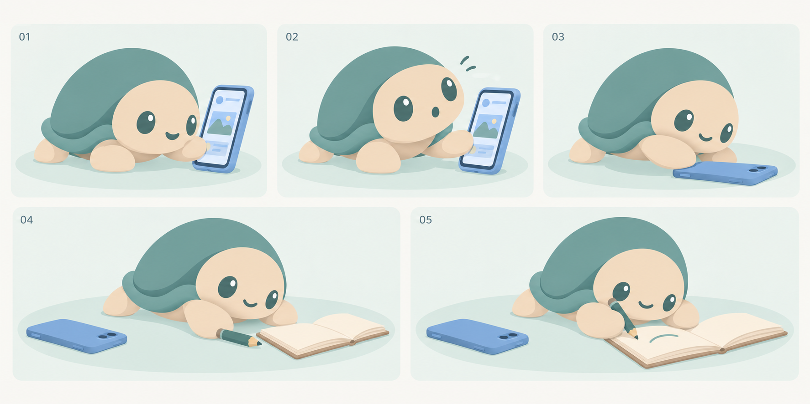
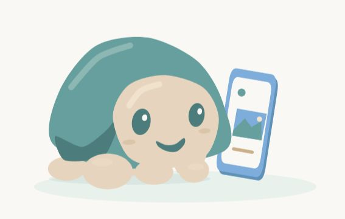
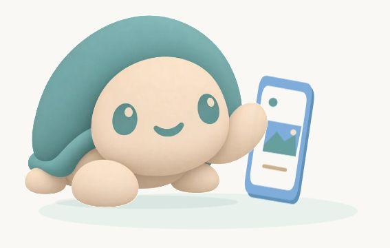
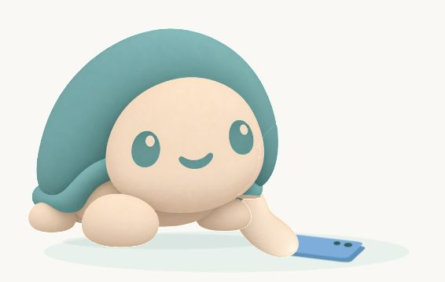
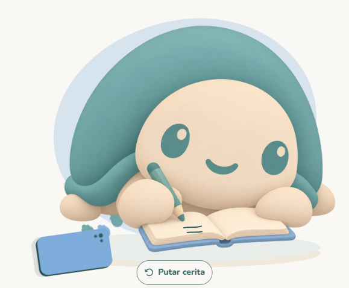
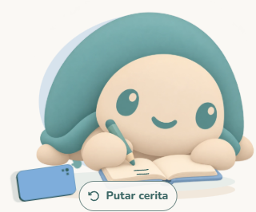

# Hero Nudge: dari scrolling ke satu kegiatan

Status: selesai untuk lingkup hero landing v7. Pengguna menerima bentuk dan geraknya pada 24 Oktober 2026 melalui jawaban “Bentuk dan geraknya sudah cocok”. Bukti teknis dan penyesuaian teknik tercatat di bagian v7.

Perilaku terbaru: atas permintaan pengguna berikutnya pada 24 Oktober 2026, hero berulang otomatis selama terlihat, tanpa tombol replay. Siklus 12 detik dan bukti pemeriksaannya tercatat pada pembaruan loop di akhir dokumen; penjelasan replay v7 di bawah merupakan riwayat versi sebelumnya.

## Masalah yang ditangani

Pengguna menolak hero SVG sebelumnya karena terasa kaku dan kurang menarik dibandingkan adegan ponsel. Perubahan berikutnya harus memperbaiki pose, tindakan, dan hubungan karakter dengan benda. Menambah jumlah keyframe atau mengganti format file saja tidak membuktikan perbaikan artistik.

Lingkup hanya hero landing, tanpa perubahan aplikasi, adegan ponsel yang sudah disukai, headline, CTA, atau handoff durasi. Identitas C1, Nunito, sage, sand, dan biru dipertahankan. Video generatif dikeluarkan dari pendekatan ini.

## Referensi terpilih dan batas penggunaan

| Referensi primer                                                                                              | Yang dipelajari untuk Nudge                                                                                  | Batas bukti dan hak penggunaan                                                                                                                                                                                    |
| ------------------------------------------------------------------------------------------------------------- | ------------------------------------------------------------------------------------------------------------ | ----------------------------------------------------------------------------------------------------------------------------------------------------------------------------------------------------------------- |
| [Duolingo: shape language](https://blog.duolingo.com/shape-language-duolingos-art-style/)                     | Siluet sederhana, variasi ukuran bentuk, ekspresi dan cerita yang terbaca sekilas.                           | Artikel dan ilustrasi sebagai referensi, bukan sumber aset Nudge. Tidak menyalin karakter atau warna merek.                                                                                                       |
| [Duolingo Lily, studi kasus Rive](https://rive.app/blog/duolingo-s-ai-powered-video-call-brings-lily-to-life) | Peralihan ekspresi, pemisahan gerak kepala/tubuh, dan respons yang menunjukkan karakter sedang berpikir.     | Sumber menjelaskan blending dan proses tim; bukan bukti bahwa rig C1 sudah tersedia atau kualitas setara dapat dicapai otomatis.                                                                                  |
| [Headspace: How It Works, Anna Charity](https://dribbble.com/shots/1802932-Headspace-How-It-Works)            | Rujukan untuk pengembangan adegan singkat dengan karakter ramah dan pesan sederhana.                         | Halaman pembuat mengonfirmasi ilustrasi Headspace dan animasi Animade. Halaman browser tidak berhasil menampilkan karya lengkap saat pemeriksaan; kualitas geraknya belum dinilai langsung. Tidak mengunduh aset. |
| Adegan ponsel Nudge, [catatan produksi](./phone-story.md)                                                     | Ponsel berdimensi, feed ilustratif, perlambatan, perubahan menuju kegiatan, lintasan buku, serta jeda akhir. | Source lokal telah diperiksa. Waktu dan properti menjadi pembanding, bukan alasan mengubah adegan yang disukai pengguna.                                                                                          |

[Turtle Walking oleh Olivia Turner](https://lottiefiles.com/free-animation/turtle-walking-bI7vP6VOur) juga ditemukan dan dilihat melalui browser. Halaman menyebut Lottie Simple License. Tidak dipilih: karakter kecil, proporsi berbeda dari C1, dan presentasinya belum menjadi adegan hero yang dibutuhkan. Tidak ada file sumber yang diunduh atau dipasang.

Taste Skill dipakai untuk pemilihan gambar, kritik fokus, serta pembandingan dengan adegan ponsel. Draw arah seluruh halaman dilewati sesuai pengecualian pekerjaan satu bagian: identitas dan komposisi halaman tetap. Impeccable animate dipakai untuk urutan tindakan dan gerak susulan; ini belum merupakan audit browser hero baru.

## Storyboard v1

Gambar konsep dibuat melalui tool ImageGen bawaan dengan `public/brand/mascot/nudge-turtle-idle.png` sebagai referensi identitas. Tool tidak mengekspos nama model. Tidak memakai referensi gambar Duolingo atau Headspace sebagai input generasi. Ini lembar pengembangan visual raster, bukan sprite sheet, rig, Lottie, atau animasi selesai.

| Momen                | Tindakan                                                      | Kebutuhan gerak produksi                                                                                                                                       |
| -------------------- | ------------------------------------------------------------- | -------------------------------------------------------------------------------------------------------------------------------------------------------------- |
| 01: tertarik layar   | C1 condong ke ponsel dengan satu kaki depan menyentuh layar.  | Pandangan dan kepala memimpin; badan menyusul. Dua kaki penyangga tetap kontak tanah. Feed memiliki gambar yang terbaca.                                       |
| 02: sadar            | Kepala terangkat, ekspresi penasaran menghadap pengunjung.    | Persiapan singkat, mata berubah lebih dahulu, kemudian kepala dan tubuh. Tidak memakai sapaan berulang sebagai aksi utama.                                     |
| 03: meletakkan       | Kaki depan menurunkan ponsel hingga telungkup.                | Titik kontak kaki dan ponsel tetap terhubung. Setelah diletakkan, C1 menggesernya ke sisi kiri sebelum mengalihkan perhatian.                                  |
| 04: memilih kegiatan | Berat badan beralih ke jurnal dan pensil.                     | Peralihan posisi ponsel dari panel 03 ke 04 harus terlihat dalam gerak penghubung, bukan teleport. Ukuran jurnal/pensil dinormalisasi dalam artboard produksi. |
| 05: mulai            | C1 membuat satu garis kecil pada jurnal dengan ekspresi puas. | Pena menyentuh halaman; garis mengikuti ujung pena. Tahan pose akhir tanpa gerak dekoratif berlebihan.                                                         |

Panel disusun untuk membaca pose, belum sebagai koordinat produksi. Kamera, ukuran karakter, ukuran ponsel, dan tanah harus konsisten ketika diturunkan ke animasi. Gaya saat ini memakai bidang warna dengan beberapa tone lembut; persetujuan pengguna diperlukan sebelum membuat aset produksi.

## Kandidat teknik dan keputusan sementara

Pilihan awal adalah Lottie melalui runtime `lottie-web` yang sudah ada, dengan animasi bentuk dan lintasan bertimeline. [Daftar fitur resmi](https://github.com/airbnb/lottie-web/wiki/Features) mencantumkan dukungan shapes, precomps, dan additive masks pada renderer SVG; ini tidak berarti tersedia rig tubuh otomatis. Cuplikan perlu membuktikan deformasi dan kontak yang baik sebelum keputusan produksi.

Source ponsel saat ini memakai 30 fps, 180 frame, playback 0,65, serta jeda akhir. Untuk C1, mulai dari cuplikan interaksi meletakkan ponsel, tanpa mengganti hero aktif. Jangan membuat seluruh adegan dari potret raster yang digeser atau anggota tubuh yang hanya diputar pada engsel.

Rive menjadi alternatif jika cuplikan menunjukkan Lottie tidak memenuhi kebutuhan. Tidak ada perintah `rive` pada PATH dan dependensi Rive belum ada di proyek. [Harga resmi yang diperiksa](https://rive.app/pricing) menyebut paket gratis dapat mengekspor dengan splash screen, sedangkan paket berbayar dapat menghilangkannya. Jangan menganggap jalur produksi tanpa branding gratis. Instalasi, runtime baru, akun, dan biaya memerlukan konfirmasi pengguna sebelum dilakukan.

Tidak ada jaminan format tertentu akan menghasilkan animasi bagus tanpa pekerjaan ilustrasi dan animasi. Jika aset yang disetujui belum dapat diproduksi dengan kualitas memadai melalui tool yang tersedia, laporkan keterbatasannya sebelum integrasi.

## Gerbang dan bukti penerimaan

- [x] Source hero, player Lottie, sumber ponsel, serta identitas C1 diperiksa.
- [x] Referensi primer dan satu kandidat aset gratis diteliti; keterbatasan visual dicatat.
- [x] Lima pose konsep tersedia secara lokal.
- [x] Pengguna menyetujui bentuk dan storyboard melalui jawaban “Setuju, lanjut ke cuplikan animasi”.
- [x] Interaksi ponsel dibuat dan diterima melalui hero final v7; persetujuan ini menggantikan gerbang cuplikan versi terdahulu yang ditolak.
- [x] Adegan lengkap diproduksi dan diintegrasikan khusus hero, dengan penyesuaian teknik v7 di bawah.
- [x] Replay, pause, reduced motion, tanpa JavaScript, kegagalan pemuatan, dan hidrasi diperiksa.
- [x] Typecheck, lint, dan Playwright landing yang relevan dijalankan.
- [x] Dua siklus ditinjau pada 1440/768/390 px serta reflow 320 px.
- [x] Pengguna menerima kualitas artistik animasi final v7 melalui jawaban “Bentuk dan geraknya sudah cocok” pada 24 Oktober 2026.

Tidak ada tes runtime baru pada tahap referensi/storyboard karena kode runtime belum berubah. Belum ada instalasi, biaya layanan animasi, push, atau klaim kelancaran Android fisik.

## Cuplikan kontak ponsel vektor v1, ditolak

Preview terpisah dapat dijalankan melalui `node scripts/preview-hero-contact.mjs`, lalu dibuka pada `http://127.0.0.1:3101/`. Preview ini tidak menambah route Next.js atau mengubah hero aktif. Regenerasi JSON melalui `node scripts/build-hero-contact.mjs`.

Cuplikan Lottie asli sepanjang 5,6 detik memuat fase mengamati, bersiap, meraih, menyentuh, menurunkan, melepas, serta menenangkan badan. Path tempurung dan kaki berubah bentuk, kepala memiliki ekspresi dan pandangan terpisah, serta bidang ponsel berubah perspektif ketika diletakkan. Koreografi disampel dari spline monoton agar gerak tidak berhenti pada setiap pose perantara. Spesifikasi 60 fps adalah timeline ekspor, bukan klaim pengukuran 60 fps pada perangkat.

Kontrol preview mencakup replay, jeda/lanjut, kecepatan normal/setengah, scrubber, dan enam pose kunci. Runtime Lottie dan font dilayani dari dependensi lokal yang sudah ada. Tidak ada pemasangan atau permintaan ke layanan pihak ketiga. Reduced motion menampilkan pose akhir sampai pengguna memilih putar; tab tersembunyi menjeda player.

Bukti tahap cuplikan:

- JSON dirender oleh `lottie_light` yang sudah terpasang; 15 layer, 551.664 byte mentah dan 107.643 byte gzip pada keluaran saat pemeriksaan. Preview lokal menyajikan JSON tanpa kompresi. Optimasi produksi masih terbuka.
- ESLint pada kedua script lulus. Format file produksi cuplikan diperiksa dengan Prettier.
- Replay melalui Enter, jeda, kecepatan setengah, dan tombol pose kunci berfungsi dalam browser.
- Pose menyentuh, menurunkan, dan meletakkan ditinjau secara visual. Lebar 390 dan 320 px tidak menunjukkan overflow horizontal.
- Pemeriksaan numerik pada 94 frame kontak menunjukkan jarak pusat kaki ke sisi ponsel maksimal 2,824 unit artboard; radius kaki 17 unit. Ini bukti keterhubungan kontak, bukan bukti kualitas estetika.
- Log error browser kosong pada pemeriksaan playback.

Saat review awal, urutan layer menutupi wajah; susunan layer dan gaya telah diperbaiki dan wajah diperiksa ulang setelah reload. Gerak meraih juga diperpanjang supaya tidak berpindah jauh dalam delapan frame.

Cuplikan belum mencakup penggeseran ponsel ke kiri atau aktivitas jurnal. Bentuk vektornya masih perlu penilaian pengguna terhadap storyboard. Reduced motion dan perpindahan tab tersedia dalam source tetapi belum diperiksa lewat emulasi browser pada tahap ini. Build aplikasi, suite landing produksi, dan Android fisik belum dijalankan untuk cuplikan yang belum terintegrasi ini. Persetujuan artistik cuplikan tetap menjadi gerbang sebelum produksi adegan penuh.

## Revisi proporsi C1 v2, ditolak

Pengguna menilai gerak meletakkan ponsel sudah bagus, tetapi bentuk karakter tidak proporsional dan berbeda dari C1 di web. Referensi identitas diperiksa langsung dari `public/brand/landing/motion/c1-idle.webp` dan storyboard yang sudah disetujui.

Revisi memperlebar wajah, memperbesar bidang tempurung hingga membingkai sisi kanan wajah, serta menghilangkan garis bayangan yang membuat kepala tampak seperti keping terpisah. Mata dibuat lebih besar, berjarak lebih lebar, dan sedikit miring; senyum menjadi bentuk melengkung berisi seperti identitas C1. Kaki depan dan belakang diperbesar serta dibulatkan. Pangkal kaki yang meraih dipindahkan ke bawah sisi kanan wajah dan ditampilkan di depan badan agar tidak terlihat tumbuh dari pelipis. Dua bentuk mulut tidak lagi memudar bersamaan sehingga tidak muncul wajah ganda.

Pemeriksaan revisi:

- Perbandingan JSON dengan commit sebelumnya menunjukkan lima layer ponsel tetap identik, termasuk bentuk, posisi, perspektif, dan timing.
- Transform lintasan kaki kontak juga identik; durasi tetap 5,6 detik. Geometri kaki serta posisi kepala disesuaikan untuk proporsi baru.
- Pose awal, menyentuh, dan meletakkan diperiksa ulang melalui render browser. Wajah, mata, kaki depan, serta ponsel terlihat.
- ESLint script dan pemeriksaan whitespace Git lulus; log error browser kosong pada pemeriksaan render revisi.
- Bukti gambar di atas adalah screenshot pose netral, bukan hasil generasi atau bukti kelancaran pada perangkat fisik.

Pemeriksaan browser awal sempat tidak dijalankan karena peninjauan persetujuan otomatis mencapai batas penggunaan. Setelah waktu reset berlalu, preview lokal dijalankan kembali dan pemeriksaan render dapat diteruskan. Pengguna kemudian menolak bentuk v2 karena masih berbeda dari C1 yang disepakati. Tidak ada instalasi, perubahan aplikasi, integrasi hero, atau push pada revisi ini.

## V3: piksel C1 asli, tanpa menggambar ulang karakter

Pengguna kembali menunjukkan C1 pada penutup landing sebagai acuan, lalu meminta implementasi. Arah terbaru menggunakan `public/brand/landing/motion/c1-wave.webp`, ekspor existing dari `nudge-turtle-wave.png`. File sumber tidak diedit. SHA256 WebP: `D7DD4678FB6D4DF57B3DF1FF4BE10CEE47BEDC95257B4903617C09A356D2385D`.

Generator tidak lagi membuat wajah, tempurung, mata, atau kaki sebagai gambar vektor. JSON kini memuat enam layer Lottie untuk ponsel/alas dan track posisi yang menyinkronkan C1. Module `c1-original-rig.js` merender gambar asli ke mesh WebGL bawaan browser: badan/kepala bergeser kecil, kaki dipisah melalui mask saat render dan mengikuti lintasan kontak yang sudah disukai. Area pangkal kaki diisi dari tekstur kaki pada gambar yang sama untuk mengurangi celah. Ini gambar 2D bertekstur pada mesh, bukan model 3D atau file rig profesional.

Tombol **Lihat aset asli** menonaktifkan deformasi dan pemisahan kaki sehingga gambar utuh yang sama dapat dibandingkan langsung dengan cuplikan. Tidak ada gambar generasi baru, atlas lama, dependensi baru, akun, atau biaya layanan animasi. Percobaan kedipan melalui deformasi piksel dibuang setelah inspeksi karena merusak bentuk mata; versi ini mempertahankan ekspresi mata dan senyum asli.

| Aset asli, tanpa deformasi                                     | Pose menyentuh pada cuplikan                                        |
| -------------------------------------------------------------- | ------------------------------------------------------------------- |
|  |  |

Bukti v3:

- Shader berhasil dikompilasi dan preview mencapai status rig siap dalam browser.
- Pose awal, menyentuh, dan meletakkan ditinjau; replay melalui Enter dan kontrol aset asli bekerja.
- Lima layer ponsel memiliki geometri serta timing identik dengan versi yang disukai; indeks internal layer boleh berubah. Track posisi kaki juga identik setelah offset koordinat.
- Lebar 390 dan 320 px diperiksa tanpa overflow horizontal; canvas tetap aktif.
- Log error browser kosong pada pemeriksaan tersebut. ESLint script/module, Prettier, dan pemeriksaan whitespace Git lulus.
- JSON: 225.325 byte mentah, 44.467 byte gzip saat pengukuran; WebP asli: 48.490 byte. Server preview belum menerapkan kompresi.

Fallback menampilkan gambar C1 asli sebelum pemuatan, jika WebGL gagal, atau jika konteks grafis hilang. Gerak mengikuti clock Lottie yang sama dengan ponsel; reduced motion mempertahankan pose diam dan tab tersembunyi menjeda clock. Jalur kegagalan grafis, reduced motion, tanpa JavaScript, serta Android fisik belum diperiksa melalui browser pada revisi ini. Belum ada klaim framerate perangkat.

V3 masih berupa cuplikan peninjauan. Keputusan gerak ponsel sudah diterima, sedangkan kualitas sambungan kaki dan hasil penerapan C1 asli perlu penilaian pengguna sebelum adegan jurnal serta integrasi hero lengkap. Route aplikasi, source aset aplikasi, dan hero aktif tidak diubah. Tidak ada push.

## V4: memperbaiki pemisahan pipi dan kaki

Pengguna menerima bentuk karakter tetapi memperlihatkan pipi terpotong dan bagian bulat bertumpuk di pangkal kaki. Seleksi warna v3 mengambil sebagian wajah bersama kaki; tambalan tekstur pangkal kaki juga bertumpuk dengan kaki penyangga.

Perbaikan memakai batas bentuk untuk mempertahankan wajah pada badan, menghapus tambalan bulat, serta memakai dua keluaran ImageGen: bagian badan tanpa kaki terangkat untuk melengkapi area tertutup, dan kaki utuh dengan pangkal yang selesai. Percobaan memotong kaki asli masih menghasilkan tepi cekung pipi, sehingga diganti dengan kaki lengkap. Badan asli dan kaki bergerak kini texture plate terpisah, dengan wajah/badan menutupi pangkal kaki. Identitas utama tetap dari master PNG asli; sumbernya tidak diedit.

Prompt, sumber, batas teknik, dan bukti pemeriksaan tercatat di [catatan aset v4](./assets/hero-redesign/c1-parts-v4.md). Layer ponsel/alas dan lintasan kaki dibandingkan dengan `60f9dd4` dan tetap identik. Pose kunci, replay, desktop, dan reflow 390/320 px ditinjau melalui browser. V4 masih menunggu penilaian artistik sebelum adegan jurnal dan integrasi hero. Tidak ada perubahan aplikasi atau push.

## V5: karakter utuh, ponsel sebagai gerak utama

Review terbaru menunjukkan kaki rig v4 masih tampak terpisah dan mengubah pose C1 dari gambar yang disetujui. Renderer v5 membuang pemisahan dan deformasi kaki. Ia menampilkan master `public/brand/mascot/nudge-turtle-wave.png` sebagai satu tekstur, dengan napas seragam yang nyaris tak mengubah siluet. Gerak ponsel yang disukai tetap sama. Copy preview kini menjelaskan bahwa ponsel berubah dari layar aktif menjadi jeda; pose kunci membantu meninjau perubahan tersebut.

Preview v5 diperiksa pada pose awal, menyentuh, meletakkan, dan tenang setelah reload di browser lokal. Karakter kembali proporsional sesuai master, sementara ponsel tetap terlihat di samping C1 pada pose akhir. Pemeriksaan ini hanya visual pada preview lokal; gerak napas halus belum dinilai oleh pengguna. Belum ada integrasi hero atau perubahan aplikasi. Adegan jurnal, integrasi landing, reduced-motion visual, reflow tambahan, dan pengujian akhir masih menunggu.

## V6: dari ponsel ke jurnal

Preview lokal menyambungkan akhir adegan ponsel dengan pose C1 yang sedang menulis pada aset `public/brand/illustrations/nudge-turtle-journal.png`. C1 tetap berupa gambar utuh; tidak ada anggota tubuh yang dipisah atau digambar ulang. Ponsel bergeser ke kiri, pose jurnal masuk, lalu dua guratan pendek muncul pada halaman. Timeline diperpanjang menjadi 7,5 detik dan menyediakan pose kunci **Awal**, **Menyentuh**, **Meletakkan**, **Jurnal**, dan **Satu garis**.

Pemeriksaan visual pada preview lokal menunjukkan pose jurnal dan alat tulis terbaca, ponsel masih tampak setelah diletakkan, dan guratan jatuh pada area halaman. Ini hanya pemeriksaan pada preview lokal; animasi belum dinilai pengguna, dan reduced motion, reflow tambahan, serta perangkat Android belum diperiksa. Belum ada perubahan hero aktif maupun route aplikasi. Tahap berikutnya adalah meminta penilaian pengguna atas cuplikan sebelum integrasi landing.

## V7: integrasi C1 utuh pada hero landing

Instruksi pengguna untuk melanjutkan implementasi diterapkan pada komponen hero aktif. Wave, think, dan journal memakai gambar C1 utuh dalam WebP transparan. Tangan, wajah, serta tempurung tidak dipotong atau dideformasi. Versi ini menggunakan transisi antarpose, pergeseran kecil seluruh gambar, dan gerak benda; artikulasi tubuh penuh pada storyboard awal belum direalisasikan. Adegan ponsel lain pada landing tetap menjadi referensi gerak.

Cerita sepanjang 9,4 detik memperlihatkan feed yang melambat, ponsel berputar hingga bagian belakangnya terlihat, C1 beralih ke pose berpikir dan menulis, lalu dua guratan muncul pada jurnal. Guratan berada dalam koordinat gambar jurnal sehingga mengikuti ukuran dan posisi C1 pada layar kecil. Timeline berhenti pada pose akhir dan dapat diputar ulang melalui tombol, klik, Enter, atau Space.

Ketiga pose harus selesai dimuat sebelum timeline dimulai. Jika unduhan WebP gagal, hero memakai gambar wave PNG asli sebagai fallback statis. Tanpa JavaScript, C1 dan ponsel tetap tersedia sebagai ilustrasi diam. Reduced motion menampilkan pose jurnal statis. Timeline dijeda saat adegan keluar layar atau tab tersembunyi, lalu dilanjutkan dari waktunya semula.

| Desktop, pose akhir | Ponsel, pose akhir |
| --- | --- |
|  |  |

Bukti pemeriksaan:

- Build produksi `npm run build -- --webpack` berhasil, termasuk TypeScript dan pembuatan halaman statis. Percobaan awal gagal karena izin sandbox untuk folder `.next`; pengulangan dengan izin yang sesuai berhasil.
- Suite landing pada Chrome desktop dan emulasi Pixel 7 menghasilkan 25 lulus dan 1 dilewati. Kasus mobile dua siklus player berlisensi dilewati karena pemeriksaan panjang itu dicakup desktop. Setelah penambahan fallback aset, 12 kasus terkait kegagalan WebP, replay, reduced motion, tanpa JavaScript, hidrasi, dan Axe diperiksa kembali dan lulus. Dua kasus replay diulang dengan batas 60 detik setelah satu kasus melewati batas 30 detik ketika build berjalan bersamaan.
- Lebar 1440, 768, 390, dan 320 px ditinjau tanpa overflow horizontal. Screenshot merupakan hasil browser lokal, bukan bukti perangkat Android fisik.
- Tiga pose dan posisi tinta jurnal diperiksa melalui snapshot timeline. Pemeriksaan Axe tidak menemukan pelanggaran otomatis pada mode statis. ESLint dan format file yang diubah diperiksa; detector Impeccable tidak melaporkan temuan pada komponen dan CSS hero.
- Dua putaran penuh melalui replay selesai pada lebar 1440, 768, dan 390 px tanpa error browser. Ini adalah pengamatan browser desktop pada viewport berbeda, bukan pengukuran framerate atau pengujian perangkat fisik.

Pengujian menggunakan preview development pada `127.0.0.1:3100` dengan service worker diblokir dalam konteks browser pengujian yang terpisah. Build produksi berhasil dikompilasi, tetapi suite ini tidak dijalankan ulang melalui server produksi. Tidak ada instalasi dependensi, perubahan source aplikasi, atau push pada integrasi ini.

Penerimaan final: pada 24 Oktober 2026 pengguna menjawab “Bentuk dan geraknya sudah cocok” setelah diminta meninjau satu putaran serta mencoba replay. Persetujuan berlaku pada hasil v7 dengan tiga pose utuh dan transisi benda yang dijelaskan di atas. Ini menutup pekerjaan hero landing dan tidak mengubah status pemeriksaan Android atau lingkup MVP lain.

## Pembaruan: loop otomatis tanpa tombol replay

Pengguna meminta label “Putar cerita” dihapus, cerita mengulang otomatis setelah selesai, serta gerak dihentikan saat tidak terlihat. Tombol ilustrasi, state replay, dan pengumuman live pengulangan dihapus. Hero sekarang berupa ilustrasi berlabel tanpa kontrol interaktif.

Seluruh gerak memakai siklus CSS 12 detik yang sama: adegan ponsel, peralihan pose, guratan jurnal, penahanan pose akhir, lalu peralihan kembali ke pose awal. Awal dan akhir properti yang terlihat dibuat sama agar batas putaran tidak melompat. Observer yang sudah ada menjeda clock saat keluar viewport atau tab tersembunyi dan melanjutkannya saat terlihat kembali. Tidak ada timer JavaScript untuk mengulang adegan. Pemuatan aset, fallback, dan reduced motion tetap tersedia.

Pemeriksaan pada Chrome desktop dan emulasi Pixel 7: 12 kasus terkait loop, berhenti di luar layar, tab tersembunyi, fallback, reduced motion, tanpa JavaScript, Axe, dan regresi hydration lulus. Dua kasus tambahan lifecycle seluruh scene juga lulus, sehingga total pemeriksaan terkait adalah 14 lulus. TypeScript, ESLint file yang diubah, dan detector Impeccable lulus tanpa temuan. Ini pemeriksaan development pada port 3100, bukan build produksi baru atau pemeriksaan Android fisik.
